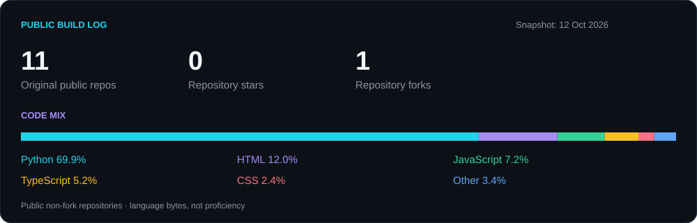
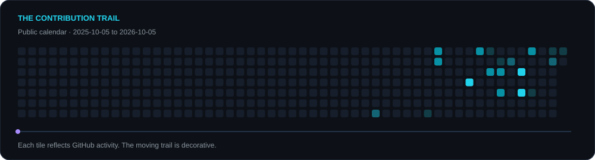

  

  
  

### Hey, I'm Rohit 👋

I build web applications and explore how AI can support security workflows. My projects span React interfaces, Node.js APIs, Python services, and systems that turn raw observations into reviewable evidence.

- **Web development:** React, Redux, Express, MongoDB, and Appwrite.
- **Security engineering:** vulnerability discovery, patch verification, and passive network analysis.
- **Current local work:** BhuNetra — satellite-image retrieval and geospatial analysis with React, FastAPI, RemoteCLIP, and FAISS.

> Build useful systems. Make the evidence easy to inspect.

## Selected projects

| Project | What to explore | Technologies |
| :--- | :--- | :--- |
| **[Prahari](https://github.com/rohitkb11/Prahari)** · Security + local AI | A C/C++ vulnerability-to-patch workflow with fuzzing, sanitizer checks, verification gates, and evidence bundles. | Python · Docker · LLVM/libFuzzer · Ollama |
| **[Dhrashta backend](https://github.com/rohitkb11/Dhrashta_backend)** · Network analysis | Passive traffic ingestion, detector integration, durable alerts, WebSocket delivery, and a separate report worker. Prototype exported from the team project; detection requires the supplied model. | FastAPI · PostgreSQL · Redis · Docker |
| **[rblog](https://github.com/rohitkb11/rblog)** · Web application | A React blogging project built with guidance from Hitesh Choudhary, using Appwrite, rich-text editing, and form/state management. **[Live demo ↗](https://mega-blog-peach.vercel.app)** | React · Redux Toolkit · Appwrite · Tailwind CSS |
| **[Video-platform backend](https://github.com/rohitkb11/youtubeclone)** · API development | Explore the user-controller and authentication code, database integration, and media-upload tooling. | Node.js · Express · MongoDB · JWT · Cloudinary |

<b>More projects & experiments</b>

- **[Sudarshan-CRS](https://github.com/rohitkb11/Sudarshan-CRS):** a separate cyber reasoning project with Python services and a React/TypeScript dashboard.
- **[React learning](https://github.com/rohitkb11/react-learning):** React practice and experiments.
- **[Dhara](https://github.com/rohitkb11/Dhara):** a climate-intelligence concept described in the repository; implementation status is not established by the public language inventory.

## Languages & tools

  

  

| Area | Project-backed tools |
| :--- | :--- |
| **Interfaces** | React · Redux Toolkit · Tailwind CSS · React Hook Form · TinyMCE |
| **APIs & data** | Express · FastAPI · MongoDB/Mongoose · PostgreSQL · Redis · Appwrite |
| **Security & local inference** | LLVM/libFuzzer · sanitizers · Docker · Ollama |
| **Geospatial work in progress** | PostGIS · Rasterio · OpenLayers · RemoteCLIP · FAISS |

## GitHub at a glance

Language share measures code bytes across public, non-fork repositories; it is not a skill rating. Cards refresh through this repository's GitHub Actions workflow.

## Contribution trail

  <b>Thanks for visiting.</b> 
  Explore a project, read its evidence, and follow the next iteration.

